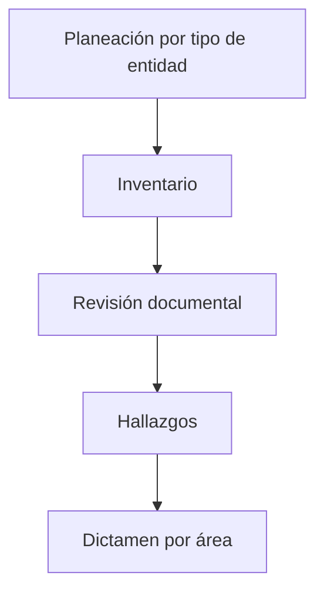

# fintech-documentation-help

Demo en el navegador, sin instalar y sin subir los archivos: [fintech-documentation-help en GitHub Pages](https://eflores1122.github.io/fintech-documentation-help/). Si el enlace aún no abre, el paso que falta está en [docs/demo.md](docs/demo.md).

> **AVISO: esta herramienta no es asesoría legal ni fiscal.** Es un checklist asistido que cita fuentes públicas y la fecha en que se verificaron. Las reglas marcadas **UNVERIFIED** (`verified: false`) todavía necesitan una lectura íntegra del instrumento oficial. Cualquier decisión de cumplimiento tiene que contrastarse con un abogado o contador autorizado y con el texto vigente en el Diario Oficial de la Federación y en los portales de SAT, CNBV, Banxico, CONDUSEF, UIF y la Cámara de Diputados. No sustituye una auditoría certificada ni un dictamen de estados financieros.

Auditor open source para el cumplimiento documental de fintechs mexicanas: IFPE, IFC, SOFOM ENR, transmisores de dinero, asesores en inversiones y modelos novedosos. El modo por defecto es el auditor más exigente (`--strictness max`).

Los casos de muestra son **Nube Pago, S.A. de C.V.** (IFPE imaginaria) y **Ladrillo Común, S.A.P.I. de C.V.** (IFC imaginaria de crowdfunding inmobiliario). No existen, no están autorizadas y no representan a ninguna empresa.

English version: [README.md](README.md).

[](https://github.com/Eflores1122/fintech-documentation-help/actions/workflows/ci.yml)

## Para quién

Oficiales de cumplimiento, contraloría interna, abogados y equipos de riesgo que quieren un expediente revisable: qué documento falta, qué texto está viejo y qué evidencia no alcanza. El catálogo se versiona por año para poder repetir la revisión cuando cambian la RMF, la LIF o una disposición de la CNBV.

## Áreas

| Área | Id | Qué mira |
|---|---|---|
| Legal y corporativo | `legal` | Autorización, objeto, consejo, poderes, NOM-151, terceros |
| Regulatorio CNBV/Banxico | `regulatorio`, `lritf`, `banxico`, `cnbv` | Capital en UDI, reportes R01, SITI, efectivo, APIs, circulares |
| Financiero y contable | `financiero` | Criterios CNBV / NIF del ejercicio, estados, auditor externo |
| Fiscal | `fiscal`, `sat` | RMF del año, CFDI 4.0, retenciones, DIOT, CFF |
| PLD/FT | `pld` | Manual, KYC, beneficiario controlador, listas, reportes, oficial |
| Ciberseguridad | `ciberseguridad` | CID, CISO en IFC, incidentes art. 67, continuidad medida |
| Privacidad | `privacy`, `privacidad` | Art. 15 LFPDPPP 2025, autoridad vigente, ARCO |
| CONDUSEF | `condusef` | RECA, consentimiento expreso, UNE, REUS, quejas |
| Riesgos | `riesgos` | Matriz, liquidez, crédito, auditoría interna |
| Operación y TI | `operacion` | Cambios, inventario, SLA, quejas operativas |
| Laboral | `laboral` | REPSE si aplica, ética, denuncias, capacitación |

ISO 27001:2022, NIST CSF 2.0, PCI DSS 4.0 (solo si el perfil procesa tarjetas), SOC 2, COSO y las 40 recomendaciones del GAFI entran como **referencia**. El informe dice que no son obligatorios en México.

## Inicio en tres comandos

Hace falta Python 3.12.

```bash
python3.12 -m venv .venv && source .venv/bin/activate && pip install -e ".[dev]"
fdh audit samples/nube_pago/docs --year 2026 --entity IFPE --out fdh-report
fdh serve
```

`fdh rules diff 2025 2026` compara snapshots. `fdh rules diff --from 2025-01-01 --to 2026-01-01` compara las reglas vigentes en dos fechas. `fdh audit ... --as-of 2031-03-15` reutiliza el último snapshot cuya vigencia cubre ese día y avisa, sin inventar el monto, si falta la UMA, el umbral de PLD o la tasa de la LIF. Si no pasa `--year` ni `--as-of`, la fecha es hoy.

`fdh rules validate` y `fdh rules list --year 2026` revisan las fichas. `fdh rules citations` lista las reglas sin URL https oficial, sin nombre de fuente o sin fecha, y sale con error si hay alguna. No propone una URL de reemplazo. Las fichas UNVERIFIED sí tienen fuente y fecha: el artículo que no se leyó se queda en blanco.

Otras figuras: `--entity IFC`, `SOFOM_ENR`, `transmisor_dinero`, `asesor_inversion`, `modelo_novedoso`. Perfil: `--operates-virtual-assets`, `--participates-spei`, `--processes-cards`, `--offers-credit`, `--offers-yield`, `--specialized-services`, `--related-parties-abroad`, `--partial-payments`, `--transports-goods`, `--tech-platform`, `--digital-services`.

`--strictness max` es el default. `standard` apaga las reglas de metodología (fecha de aprobación, placeholders, versión de trabajo). `--fail-on critical` sale con código 1 si hay un incumplimiento de esa severidad o peor.

Formatos: `md,html,json,csv,xlsx,pdf,ics`. El HTML trae los diagramas en SVG y en Mermaid. El PDF es texto, sin motor pesado.

## Muestras

| Entidad ficticia | Comando | Global (estrictez max, sin IA) | Dictamen |
|---|---|---:|---|
| Nube Pago, IFPE | `fdh audit samples/nube_pago/docs --entity IFPE` | 8.8 | adverso |
| Ladrillo Común, IFC | `fdh audit samples/ladrillo_comun/docs --entity IFC` | 22.2 | adverso |

Los reportes están en [`examples/nube_pago/`](examples/nube_pago/report.md) y [`examples/ladrillo_comun/`](examples/ladrillo_comun/report.md). El diff anual está en [`examples/diff-2025-2026.md`](examples/diff-2025-2026.md).

Nube Pago, por área: ciberseguridad 0, CONDUSEF 0, financiero 0, fiscal 0, laboral 33.3, legal 8.3, metodología 0, operación 22.2, PLD 8.8, privacidad 6.9, regulatorio 21.9, riesgos 0.

Ladrillo Común, por área: ciberseguridad 0, CONDUSEF 9.7, financiero 0, fiscal 12.0, laboral 66.7, legal 29.6, metodología 72.7, operación 0, PLD 52.6, privacidad 13.8, regulatorio 0, riesgos 76.9.

## Diagramas

`fdh diagrams --out fdh-diagramas` escribe Mermaid y SVG (el SVG no necesita Mermaid CLI; si `mmdc` está en el PATH, el HTML lo dice). Sirven como plantilla para documentar la propia fintech:



También: mapa de áreas, flujo PLD, incidentes, quejas CONDUSEF, gobierno, Gantt de recordatorios y flujo de datos personales. La interfaz los muestra en `/diagrams`.

## IA local

Todo funciona sin modelo. Para uno en la misma máquina:

```bash
# Ollama, LM Studio, llama.cpp o vLLM: endpoint compatible con OpenAI, en localhost
export FDH_LLM_PROVIDER=ollama
export FDH_LLM_MODEL=qwen2.5:7b
fdh llm doctor
fdh audit samples/nube_pago/docs --llm --adversarial
```

Modelos sugeridos: `qwen2.5:7b`, `qwen2.5:14b`, `llama3.1:8b`, `llama3.2:3b`, `mistral:7b`.

`fdh ask "¿qué elementos pide el aviso de privacidad?"` responde con las fichas del catálogo (búsqueda léxica). Embeddings solo si `FDH_LLM_EMBEDDINGS=1` y Ollama está en local. Un endpoint remoto exige `FDH_LLM_ALLOW_REMOTE=1`. Sin eso, el texto no sale de la máquina. Detalle en [SECURITY.md](SECURITY.md).

La IA agrega hallazgos con `source: mixed` y confianza. No inventa `rule_id` y no baja la severidad. Las reglas determinísticas siguen siendo la base.

## Cada año

```bash
fdh rules new-year 2027
fdh rules diff 2026 2027
fdh rules validate
```

`new-year` clona la carpeta y abre `CHECKLIST.md`. Quien no programa copia un bloque YAML, pone la URL oficial y, si no leyó el artículo, `unverified: true`. La guía está en [CONTRIBUTING.md](CONTRIBUTING.md). El historial de catálogo está en [rules/CHANGELOG.md](rules/CHANGELOG.md).

La acción `.github/workflows/rules-watch.yml` corre cada lunes, compara hashes de páginas del SAT, Banxico, Diputados y el DOF, y abre un issue si algo cambió. No redacta reglas sola. `fdh rules watch` hace lo mismo en local.

## Interfaz

`fdh serve` abre `http://127.0.0.1:8000`. Ahí se elige la figura, la estrictez, se suben documentos y se leen hallazgos, diagramas (`/diagrams`), plantillas (`/templates`) y el calendario (`/calendar.ics`).

`fdh calendar --entity IFPE --year 2026 --out obligaciones.ics` exporta recordatorios. Donde la norma dice «dentro del mes inmediato siguiente», el evento es un recordatorio el día 10, no un día legal inventado.

`fdh templates --out fdh-plantillas` escribe borradores de manual PLD, seguridad, continuidad, privacidad, quejas y gobierno. Cada archivo dice que un abogado debe revisarlo.

## Docker

```bash
docker compose up --build
# con Ollama, en otro perfil:
docker compose --profile ollama up --build
```

Dentro del compose, `FDH_LLM_BASE_URL` apunta a `http://ollama:11434/v1`. Hay que bajar el modelo en ese servicio (`ollama pull qwen2.5:7b`) y exportar `FDH_LLM_PROVIDER=ollama` si quiere el revisor.

## Metodología y fuentes

[docs/metodologia.md](docs/metodologia.md) y [docs/fuentes.md](docs/fuentes.md). El contexto de la investigación previa sigue en [RESEARCH.md](RESEARCH.md).

## Aviso, otra vez

Este software no es asesoría legal ni fiscal, no autoriza a operar y no reemplaza a la CNBV, Banxico, el SAT, la UIF ni CONDUSEF. Las fichas UNVERIFIED no se deben citar como texto cerrado.
