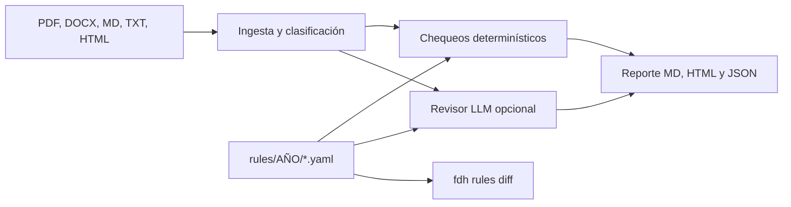

# fintech-documentation-help

> **AVISO: esta herramienta no es asesoría legal ni fiscal.** Es un checklist asistido que cita fuentes públicas y la fecha en que se verificaron. Las reglas marcadas **UNVERIFIED** todavía necesitan una lectura íntegra del instrumento oficial. Cualquier decisión de cumplimiento tiene que contrastarse con un abogado o contador autorizado y con el texto vigente en el Diario Oficial de la Federación y en los portales de SAT, CNBV, Banxico, CONDUSEF, UIF y la Cámara de Diputados.

Auditor open source de documentación para fintechs mexicanas (ITF: IFPE, IFC y figuras afines). Revisa avisos de privacidad, contratos de adhesión, manuales PLD/FT, políticas de seguridad de la información y continuidad, procesos de CFDI y la divulgación de riesgos, UNE y REUS. Dice qué falta, qué está mal y qué quedó desactualizado frente a la regulación usada en el catálogo del año elegido.

El caso de muestra es **Nube Pago, S.A. de C.V., IFPE imaginaria**. No existe, no está autorizada y no representa a ninguna empresa.

[](https://github.com/Eflores1122/fintech-documentation-help/actions/workflows/ci.yml)

## Qué hace

1. Lee PDF, DOCX, Markdown, TXT y HTML.
2. Clasifica el tipo de documento con heurísticos (nombre y frases). Si se enciende el revisor de modelo de lenguaje, solo puede añadir etiquetas del vocabulario cerrado.
3. Corre chequeos determinísticos del catálogo YAML del año (`must` / `must not`, grupos de secciones, patrones, referencias viejas como «INAI», leyendas ausentes).
4. Opcionalmente llama a un revisor compatible con la API de OpenAI. El modelo solo puede devolver un `rule_id` que ya está en el catálogo y un fragmento literal del archivo. Si inventa una obligación, el hallazgo se tira.
5. Escribe Markdown, HTML y JSON: puntaje por dominio, severidad, evidencia, corrección sugerida y URL oficial.
6. `fdh rules diff 2025 2026` explica qué cambió entre catálogos. Sin clave de ningún modelo, todo lo anterior sigue funcionando.



## Inicio rápido

Hace falta Python 3.12.

```bash
python3.12 -m venv .venv
source .venv/bin/activate
pip install -e ".[dev]"

fdh audit samples/nube_pago/docs --year 2026 --entity IFPE --out fdh-report
fdh rules diff 2025 2026
fdh rules list --year 2026
fdh rules validate
fdh serve
```

`fdh serve` abre un formulario local en `http://127.0.0.1:8000`. La casilla del modelo viene apagada.

Otras banderas de `fdh audit`:

| Bandera | Efecto |
|---|---|
| `--entity IFPE\|IFC\|ITF\|fintech_general\|...` | Filtra reglas. La retención de la LIF 2026 solo entra si la entidad es IFC. |
| `--operates-virtual-assets` | Activa las leyendas de activos virtuales. |
| `--partial-payments` | Activa el complemento de recepción de pagos. |
| `--transports-goods` | Activa Carta Porte. |
| `--tech-platform` | Activa el régimen de plataformas tecnológicas. |
| `--digital-services` | Activa IVA de servicios digitales. |
| `--llm` | Envía texto al proveedor de `FDH_LLM_BASE_URL`. Apagado por omisión. |
| `--fail-on critical` | Sale con código 1 si hay un incumplimiento de esa severidad o peor. |

El revisor opcional usa `FDH_LLM_API_KEY`, `FDH_LLM_BASE_URL` (omisión `https://api.openai.com/v1`) y `FDH_LLM_MODEL` (omisión `gpt-4o-mini`). `FDH_LLM_ENABLED=0` lo apaga aunque haya clave. `FDH_RULES_DIR` apunta a otra copia del catálogo.

No mande documentos confidenciales a un tercero. El detalle está en [SECURITY.md](SECURITY.md).

## Salida de la muestra

`fdh audit samples/nube_pago/docs --year 2026 --entity IFPE` (sin modelo de lenguaje) deja un puntaje general de **7.6 / 100**:

| Dominio | Puntaje |
|---|---:|
| Datos personales (`privacy`) | 9.5 |
| LRITF (`lritf`) | 9.7 |
| Banxico / IFPE (`banxico`) | 0.0 |
| CNBV (`cnbv`) | n/a (solo informativa) |
| PLD/FT (`pld`) | 12.2 |
| CONDUSEF (`condusef`) | 0.0 |
| SAT / fiscal (`sat`) | 0.0 |

35 incumplimientos (13 críticos, 15 altos, 6 medios, 1 informativo), 3 cumplimientos y 5 reglas no aplicables al perfil. Tres reglas del catálogo no se corren: dos son internas de la herramienta y la retención ISR/IVA de la LIF 2026 es solo para IFC.

Cumple, a propósito, el departamento de datos personales, el procedimiento KYC y la política de conflictos de interés. Entre los huecos:

- El aviso cita al **INAI** como autoridad vigente y no distingue las finalidades que requieren consentimiento ni dice cómo se comunican los cambios (LFPDPPP art. 15).
- El contrato dice **inscripción RECA pendiente** y se acepta **al continuar navegando**.
- El oficial de cumplimiento está **vacante** y sin certificación CNBV.
- La política fiscal sigue anclada a la **RMF 2025** y a **CFDI 3.3**.

Los tres hallazgos fiscales con número de regla o encuadre fino sin lectura íntegra salen marcados **UNVERIFIED**. El reporte completo está en [`examples/nube_pago/`](examples/nube_pago/report.md). El diff anual está en [`examples/diff-2025-2026.md`](examples/diff-2025-2026.md).

Fragmento real del reporte:

```markdown
### Incumplimiento · high · `privacy-no-citar-inai`

**No citar al INAI como autoridad vigente**

Se revisó aviso_de_privacidad.md. Se encontró al INAI o al Instituto Nacional de Transparencia como autoridad vigente: «INAI».

- Corrección sugerida: Sustituya toda referencia al INAI como autoridad vigente por la Secretaría Anticorrupción y Buen Gobierno y cite la LFPDPPP publicada el 20 de marzo de 2025.
- Fuente: LFPDPPP arts. 2-XV, 38–39; Transitorios DOF 20-mar-2025

### Incumplimiento · high · **UNVERIFIED** · `sat-cfdi40-emision`

**Proceso documentado de emisión de CFDI 4.0**

Se revisó politica_cfdi.md. No aparece CFDI versión 4.0.
```

## Cobertura del catálogo

46 reglas en 2026 y 44 en 2025. La diferencia son la LIF 2026 para IFC, el relevo de la RMF 2025 por la RMF 2026 y la regla interna del diff. Privacidad, LRITF, PLD y CONDUSEF se conservan: siguieron vigentes. El comando `fdh rules diff 2025 2026` lo explica con fuente y fecha.

| Dominio | Id | 2026 | 2025 | Qué mira |
|---|---|---:|---:|---|
| Datos personales | `privacy` | 7 | 7 | Art. 15 LFPDPPP, INAI, consentimiento financiero, ARCO, medidas y vulneraciones |
| LRITF | `lritf` | 9 | 9 | No garantía gubernamental, segregación, riesgos, seguridad, conflictos, fraude, continuidad, 10 años, activos virtuales |
| Banxico | `banxico` | 1 | 1 | Continuidad y seguridad IFPE (DOF 28-ene-2021) |
| CNBV | `cnbv` | 1 | 1 | Índice de Normatividad Fintech (informativa) |
| PLD/FT | `pld` | 10 | 10 | Manual art. 58, RBA, reportes, KYC, oficial certificado, auditoría, lista de bloqueados, 10 años, DCG, reforma LFPIORPI 2025 |
| CONDUSEF | `condusef` | 7 | 7 | RECA, consentimiento expreso, carátula, UNE, REUS, términos, comisiones |
| SAT / fiscal | `sat` | 9 | 8 | Calendario RMF, RMF del ejercicio, CFDI 4.0, REP, Carta Porte, plataformas, LIF 2026 solo IFC, CFF 32-B, IVA digital |
| Meta | `meta` | 2 | 1 | Aviso de la herramienta y diff anual. No se auditan contra documentos del cliente |

Tres reglas de SAT siguen **UNVERIFIED** en ambos años: el número de regla de CFDI en la RMF, el plazo del complemento de pagos y el encuadre exacto del art. 32-B del CFF para cada ITF. La URL de esa última ficha es la que traía la semilla de investigación y hay que cruzarla con el PDF vigente del CFF.

## Catálogo y severidad

Las reglas viven en `rules/<año>/*.yaml` con `effective_date`, `source_url`, `last_verified` y, cuando toca, `supersedes`, `applies_if` y `diff_note`. Cómo se agrega un año nuevo está en [CONTRIBUTING.md](CONTRIBUTING.md). La plantilla de pull request exige la URL oficial.

| Severidad | Uso |
|---|---|
| `critical` | Obligación cuyo incumplimiento deja el documento inutilizable frente al supervisor o al cliente (sin RECA, sin manual PLD, aviso sin el art. 15). |
| `high` | Desactualización material (INAI, RMF del año anterior, oficial sin certificación). |
| `medium` | Documento incompleto o ambiguo. |
| `low` | Claridad. |
| `info` | Recordatorio. No mueve el puntaje. |

El puntaje es la suma ponderada de lo que sí aplica: crítico 5, alto 3, medio 2, bajo 1, info 0. Cumplir vale el peso completo, un resultado no concluyente vale la mitad y fallar vale cero. Lo marcado «no aplica» sale del denominador.

## Hoja de ruta

- Leer los PDF de la RMF 2026 y del CFF y quitar `unverified` solo donde el número de regla haya quedado asentado.
- Índice de la RMF en el hub del SAT (títulos y hashes). Una persona confirma la regla nueva; el programa no la inventa.
- No automatizar portales del DOF que pidan sesión.
- Más estructura en carátulas (anexos 1 a 3 de las disposiciones de CONDUSEF) cuando el formato se contraste con el texto oficial.
- Paquetes de muestra para una IFC ficticia, separados de Nube Pago.

El contexto de fuentes está en [RESEARCH.md](RESEARCH.md).

## Desarrollo

```bash
ruff check src tests scripts
ruff format --check src tests scripts
pytest
```

La integración continua corre lo mismo en Python 3.12. Licencia MIT.

## English

> **This is not legal or tax advice.** It is an assisted checklist with public citations and a verification date. Rules flagged **UNVERIFIED** still need a full read of the official instrument. Compliance decisions belong with a qualified lawyer or accountant and the current text on the official sites.

`fintech-documentation-help` reviews a Mexican fintech's documents (privacy notice, adhesion contracts, AML manual, information-security and continuity policies, CFDI procedures, risk disclosure, UNE/REUS) against a versioned YAML catalog (`rules/2025`, `rules/2026`). It reports what is missing, wrong or outdated, with severity, the rule id, the official URL and a concrete fix.

The sample company, **Nube Pago, S.A. de C.V.**, is fictitious.

```bash
pip install -e ".[dev]"
fdh audit samples/nube_pago/docs --year 2026 --entity IFPE --out fdh-report
fdh rules diff 2025 2026
fdh serve
```

Deterministic checks always run. The optional reviewer speaks the OpenAI chat-completions protocol (`FDH_LLM_API_KEY`, `FDH_LLM_BASE_URL`, `FDH_LLM_MODEL`) and is off unless you pass `--llm`. It may only cite a catalog rule id and a verbatim snippet. Do not send confidential documents to a third-party model; see [SECURITY.md](SECURITY.md).

On the synthetic IFPE file set the score is **7.6 / 100**, with failures that include an INAI citation, a pending RECA number, tacit acceptance by continuing to browse, a vacant compliance officer, and a tax policy still pinned to the 2025 miscellaneous tax resolution. The LIF 2026 interest withholding rule is IFC-only and is omitted for this IFPE. Full output: [`examples/nube_pago/report.md`](examples/nube_pago/report.md). Annual catalog diff: [`examples/diff-2025-2026.md`](examples/diff-2025-2026.md).

How to add a regulatory year is described in [CONTRIBUTING.md](CONTRIBUTING.md): copy the catalog, keep official URLs, leave `unverified: true` when the PDF was not read through, and paste `fdh rules diff` into the pull request.
