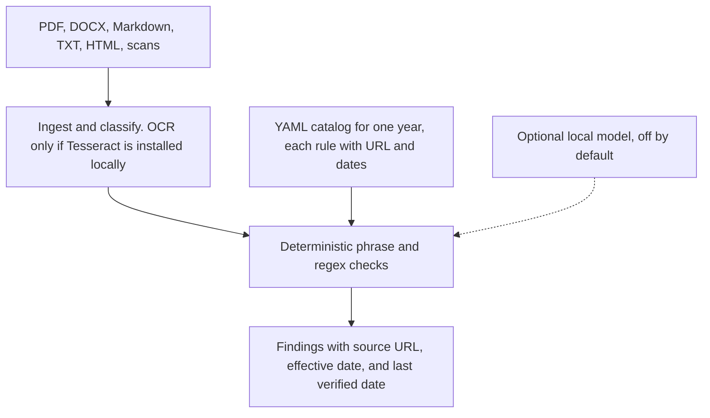

# fintech-documentation-help

Open-source checklist that reviews Mexican fintech documentation against public SAT, CNBV, Banxico, CONDUSEF, and UIF sources, and shows the official URL and the date each rule was checked.

> **This is not legal or tax advice.** It is an assisted checklist. Rules marked **UNVERIFIED** keep their public citation and still need a full reading of the official instrument. Compliance decisions belong with a qualified lawyer or accountant and with the current text in the Diario Oficial de la Federación and on the SAT, CNBV, Banxico, CONDUSEF, UIF, and Chamber of Deputies sites.
>
> **AVISO: Este reporte no es asesoría legal ni fiscal.** Es un checklist asistido que cita fuentes públicas con fecha de verificación. Las reglas marcadas UNVERIFIED requieren lectura íntegra del instrumento oficial antes de tratarlas como definitivas.

In-browser demo, with no install and no upload to a server: [GitHub Pages](https://eflores1122.github.io/fintech-documentation-help/). If the link is not live yet, the remaining step is in [docs/demo.md](docs/demo.md).

Spanish documentation: [README.es.md](README.es.md).

[](https://github.com/Eflores1122/fintech-documentation-help/actions/workflows/ci.yml)

The sample companies are fictional: **Nube Pago, S.A. de C.V.** (an imaginary payment institution, IFPE) and **Ladrillo Común, S.A.P.I. de C.V.** (an imaginary real-estate crowdfunding institution, IFC). They are not authorized and they do not represent a real firm. The files under `samples/` and the reports under `examples/` are synthetic.

## Problem

A fintech filing is a pile of manuals, policies, contracts, and scanned PDFs. The texts that matter change by year: the Resolución Miscelánea Fiscal, the Ley de Ingresos, CNBV dispositions, Banxico circulars, CONDUSEF transparency rules, and the anti-money-laundering provisions overseen with the UIF. Teams need a repeatable way to see which document is missing, which sentence is stale, and which citation was actually read.

## What it checks

Default mode is the strictest auditor (`--strictness max`). Entity types include IFPE, IFC, SOFOM ENR, money transmitters, investment advisers, and sandbox filings (`modelo novedoso`).

| Area | Rule domain ids |
|---|---|
| Legal and corporate | `legal` |
| CNBV and Banxico | `regulatorio`, `lritf`, `banxico`, `cnbv` |
| Financial reporting | `financiero` |
| Tax | `fiscal`, `sat` |
| Anti-money laundering | `pld` |
| Cybersecurity | `ciberseguridad` |
| Privacy | `privacy`, `privacidad` |
| CONDUSEF | `condusef` |
| Risk, operations, labor | `riesgos`, `operacion`, `laboral` |

ISO/IEC 27001:2022, NIST CSF 2.0, PCI DSS 4.0 (only if the profile processes cards), SOC 2, COSO, and the FATF recommendations are reference mappings. The report says they are not Mexican law.

## Architecture



The model, when enabled, may only add a finding that names an existing rule id and quotes the file. It does not lower severity and it does not create a new obligation.

## Tech stack

Python 3.12. Pydantic v2 for the rule schema. PyYAML catalogs. FastAPI and Uvicorn for the local UI. pypdf, python-docx, and the standard library for text. Pillow and pytesseract for local OCR. ReportLab for a text PDF. httpx only when a local OpenAI-compatible model is switched on. Ruff, mypy, and pytest in CI.

## Quickstart

Python 3.12. Scanned images are read only when Tesseract and the Spanish language pack are installed. Without them, the audit still runs and the image is reported as unread. Nothing is sent to a cloud OCR service.

```bash
python3.12 -m venv .venv
source .venv/bin/activate
pip install -e ".[dev]"
fdh audit samples/nube_pago/docs --year 2026 --entity IFPE --out fdh-report
fdh rules citations
fdh serve
```

`fdh serve` listens on `http://127.0.0.1:8000`.

`fdh rules diff 2025 2026` compares the two catalog snapshots. `fdh rules validate` checks the YAML. `fdh rules citations` exits with an error if any rule lacks an official https source, a source name, or a date. It does not fill that gap with a guessed URL.

Other entities: `--entity IFC`, `SOFOM_ENR`, `transmisor_dinero`, `asesor_inversion`, `modelo_novedoso`. Profile flags include `--operates-virtual-assets`, `--participates-spei`, `--processes-cards`, `--offers-credit`, and `--offers-yield`.

Exports: `md,html,json,csv,xlsx,pdf,ics`.

```bash
docker compose up --build
```

## Sample output

Checked-in run, strictness `max`, no model. Full files: [examples/nube_pago/report.md](examples/nube_pago/report.md) and [examples/ladrillo_comun/report.md](examples/ladrillo_comun/report.md).

| Fictional entity | Command | Overall | Opinion |
|---|---|---:|---|
| Nube Pago, IFPE | `fdh audit samples/nube_pago/docs --entity IFPE` | 8.8 | adverse |
| Ladrillo Común, IFC | `fdh audit samples/ladrillo_comun/docs --entity IFC` | 22.2 | adverse |

Nube Pago by area: cybersecurity 0, CONDUSEF 0, financial 0, tax 0, labor 33.3, legal 8.3, methodology 0, operations 22.2, PLD 8.8, privacy 6.9, regulatory 21.9, risk 0. The run shows 99 fails, 17 of them critical, and 59 UNVERIFIED findings.

One critical finding from that synthetic file, kept UNVERIFIED because the article number was not read:

```text
### Incumplimiento · critical · UNVERIFIED · legal-oficio-autorizacion
Oficio de autorización para operar como ITF
Fuente: LRITF (autorización de ITF; artículo no releído)
https://www.diputados.gob.mx/LeyesBiblio/pdf/LRITF.pdf
vigencia 2018-03-09 · verificado 2026-11-06
UNVERIFIED: No se leyó el artículo completo en la pasada del 2026-11-06.
```

The annual catalog diff is [examples/diff-2025-2026.md](examples/diff-2025-2026.md).

## Tests

GitHub Actions (`.github/workflows/ci.yml`) installs Tesseract, then runs Ruff, mypy, and pytest. Coverage of `fdh` fails under 90%.

```bash
ruff check src tests scripts
ruff format --check src tests scripts
mypy src/fdh
pytest
```

## Project structure

```text
src/fdh/          CLI, catalog loader, matchers, reports, local web UI
rules/2025/       catalog snapshot for 2025
rules/2026/       catalog snapshot for 2026
rules/parameters.yaml
rules/schemas/    JSON Schema for editors. Runtime checks are Pydantic.
samples/          synthetic Nube Pago and Ladrillo Común documents
examples/         checked-in reports from those samples
tests/            pytest
site/             static demo
docs/             methodology and the source pass
.github/workflows/ci.yml
```

## Limitations

- A lawyer or accountant, and the current official text, decide compliance. This repository does not authorize a firm to operate and does not replace CNBV, Banxico, SAT, UIF, or CONDUSEF.
- Matchers look for phrases and patterns in the file. A paraphrase can pass or fail for the wrong reason.
- `UNVERIFIED` keeps the official URL, the effective date, and the verification date. The unread article number, RMF rule number, or amount stays blank. `fdh rules citations` lists those rows and refuses a rule that has no official source.
- Two product rows cite an official page as an anchor rather than as the norm that imposes the check: `meta-disclaimer-no-legal-advice` and `meta-what-changed-2026`. `sat-cff-32b-informacion` still points at the LRITF PDF because the CFF article was not read. Those URLs were not replaced.
- Parameter rows with an empty value table (`uma_diaria`, the PLD relevant-transaction threshold, and the LIF withholding rates marked unverified) do not borrow a number from another year.
- Samples and examples are synthetic. This repository does not claim a production deployment.
- The optional model stays on the machine unless `FDH_LLM_ALLOW_REMOTE=1`. See [SECURITY.md](SECURITY.md).

Methodology: [docs/metodologia.md](docs/metodologia.md). Source pass: [docs/fuentes.md](docs/fuentes.md). How to add a rule: [CONTRIBUTING.md](CONTRIBUTING.md).

## License

[MIT](LICENSE). Copyright (c) 2026 fintech-documentation-help contributors.
